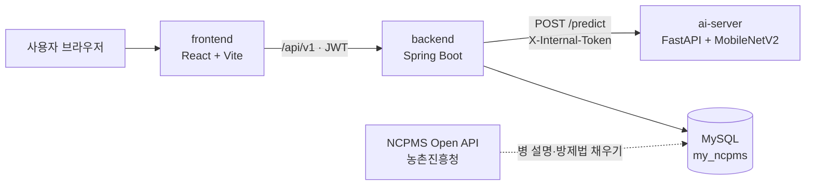

# crop-ai — 작물 잎 사진 병해 진단 앱

토마토·감자·옥수수 **잎 사진 한 장**을 올리면 가능성 높은 병 3개와 확률, 병 설명·방제법을 보여주는 웹 앱입니다.
**개인 프로젝트**이며, AI 모델 학습부터 추론 서버, 백엔드, 화면까지 직접 만들었습니다.

> AI 진단 결과는 참고용입니다. 실제 방제는 지역 농업기술센터 등 전문가와 상의하세요.

---

## 구성

| 폴더 | 내용 | 기술 |
|---|---|---|
| `ai-server/` | 사진 → 병 후보 3개 추론 서버, 학습·평가 코드, 병 정보 DB 도구 | Python 3.12, FastAPI, TensorFlow 2.21 / Keras 3.13, MobileNetV2 |
| `backend/` | 회원가입·로그인(JWT), 진단 요청·기록, 병 정보 API | Java 21, Spring Boot 4.1, Spring Security, JPA, MySQL 8.4 |
| `frontend/` | 진단·결과·기록·병 정보·내 정보 화면 | React 19, TypeScript, Vite 8, React Router |
| `docs/` | API 명세, 설치·데이터 재생성 안내 | |

## 주요 기능

- **진단**: 작물 선택 → 사진 촬영/업로드 → 후보 3개 + 확률, 판정(정상·가능성 높음·의심·불확실)
- **작물 마스킹**: 고른 작물의 병 안에서만 결과를 계산 (토마토 사진이 감자 병으로 나오지 않게)
- **병 정보**: 17종 설명·방제법 (농촌진흥청 NCPMS 공공데이터)
- **기록**: 내 진단 목록·상세·사진, 결과 맞음/틀림 피드백, 삭제
- **회원**: 아이디·비밀번호 가입, 정보 수정, 비밀번호 변경, 탈퇴(기록·사진 함께 삭제)

## 보안 설계

| 항목 | 처리 |
|---|---|
| 비밀번호 | BCrypt 해시로만 저장, 영문+숫자·아이디 포함 금지 규칙 |
| 로그인 시도 | 5회 연속 실패 시 15분 잠금, 없는 아이디도 같은 응답·같은 시간(아이디 존재 여부 노출 방지) |
| 인증 | JWT(HS256, 60분), 세션·쿠키 없음, 401/403도 공통 오류 형식 |
| 권한 | 다른 회원의 진단 기록·사진 접근 시 403 |
| 업로드 | 10MB 제한, 확장자가 아닌 파일 앞부분(매직 바이트)으로 jpg/png 판별, 저장 경로는 서버가 생성 |
| 내부 통신 | AI 서버는 127.0.0.1 에서만 대기, Spring ↔ AI 서버는 공유 토큰 + 상수 시간 비교 |
| 비밀값 | DB 비밀번호·토큰·서명 키는 환경변수로만 주입, 저장소에 없음 |
| DB 계정 | 앱 계정은 `my_ncpms` 데이터 읽기·쓰기만 (테이블 생성·변경 권한 없음) |
| 모델 파일 | 저장소에는 gpg(AES256)로 암호화한 `models.tgz.gpg` 만 포함 |

## 모델 결과 (모델 `20261118-1305`)

PlantVillage 17클래스, Colab T4 GPU, 2단계 전이학습(분류층 5에폭 → 상위 30층 미세조정 10에폭).

| 지표 | 값 |
|---|---|
| 검증 top-1 / top-3 (17클래스) | 93.8% / 99.5% |
| 작물 마스킹 적용 top-1 / top-3 | 94.1% / 99.6% |
| 온도 보정 | T = 1.15 |

**한계 (실제 사진 시험)** — 검증 사진은 단색 배경의 실험실 사진이라, 실제 밭 사진에서는 성능이 낮습니다.
특히 **학습하지 않은 병**(토마토 잿빛곰팡이병, 감자 바이러스 등)도 아는 병 중 하나로 **높은 확률로 단정**하는 문제가 있습니다.
그래서 화면은 확률과 관계없이 항상 후보 3개와 "참고용" 안내를 함께 보여주고, `99% 이상`·`1% 미만`처럼 단정하지 않게 표시합니다.
개선 계획: 실제 환경 사진 추가 학습, "기타/모름" 클래스 추가, 사용자 피드백(틀림) 사진으로 재학습.

## 실행하기

저장소에는 **모델 파일, 학습 사진, 비밀값, 시험용 실제 사진**이 들어 있지 않습니다.
처음부터 다시 만드는 방법은 **[docs/setup.md](docs/setup.md)** 에 순서대로 정리했습니다.

- API 명세: [docs/api-spec.md](docs/api-spec.md)
- AI 서버 상세: [ai-server/README.md](ai-server/README.md)

## 데이터 출처

| 데이터 | 출처 | 비고 |
|---|---|---|
| 학습 사진 | [PlantVillage Dataset](https://github.com/spMohanty/PlantVillage-Dataset) | 저장소에 포함하지 않음. 원본의 이용 조건을 따름 |
| 병 설명·방제법 | 농촌진흥청 국가농작물병해충관리시스템(NCPMS) Open API | 공공누리 제2유형(출처 표시, 상업적 이용 금지). 앱 화면에 출처 표시 |
