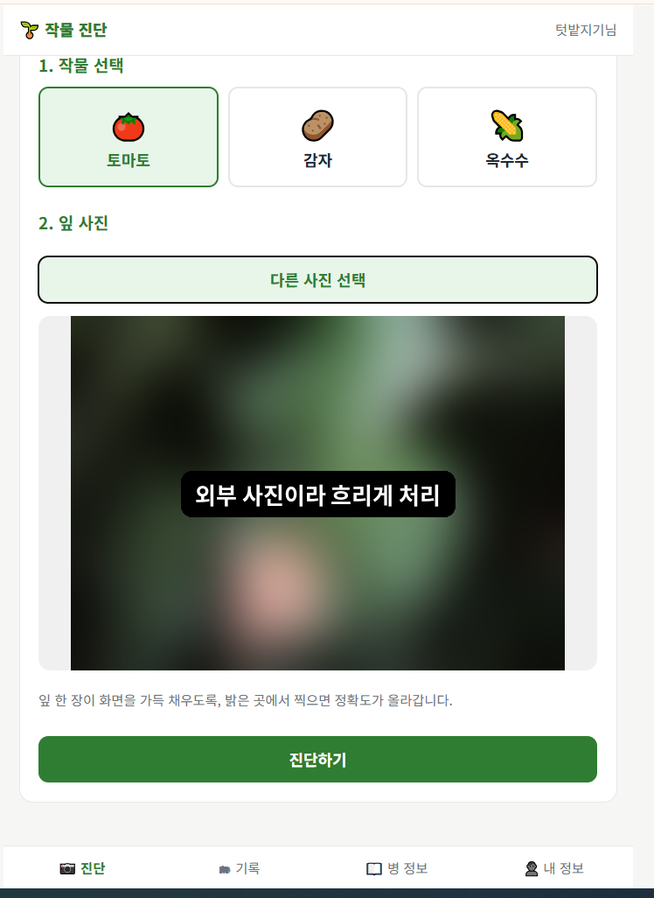
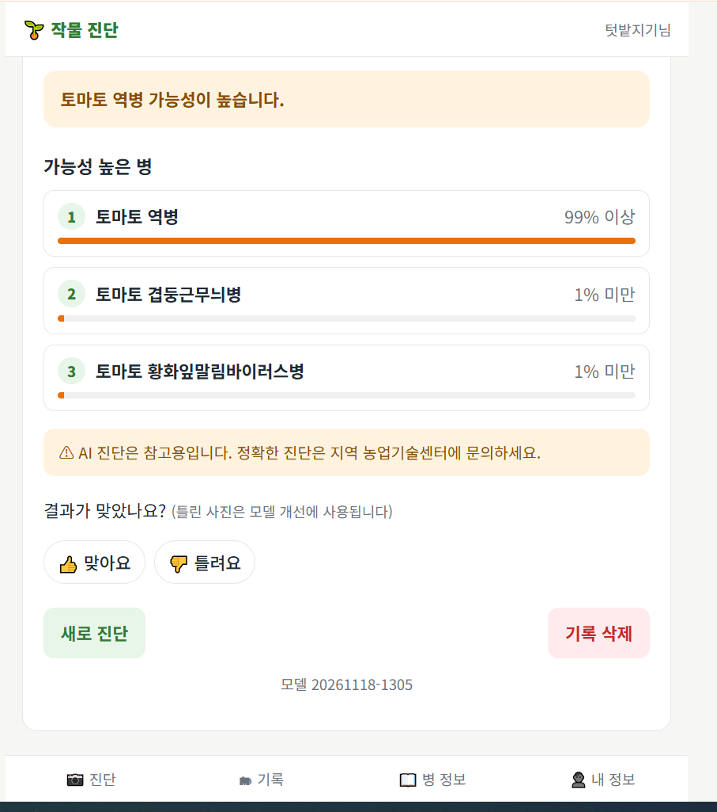

# crop-ai — 작물 잎 사진 병해 진단 앱

     

토마토·감자·옥수수 **잎 사진 한 장**을 올리면 가능성 높은 병 3개와 확률, 병 설명·방제법을 보여주는 웹 앱입니다.
**개인 프로젝트**이며 AI 모델 학습, 추론 서버, 백엔드, 화면, DB까지 모두 직접 만들었습니다.

> ⚠️ AI 진단 결과는 참고용입니다. 실제 방제는 지역 농업기술센터 등 전문가와 상의하세요.

| 진단 화면 | 결과 화면 |
|---|---|
|  |  |

---

## 목차

1. [구성](#1-구성)
2. [주요 기능](#2-주요-기능)
3. [폴더 구조](#3-폴더-구조)
4. [🔐 저장소에 없는 것 — 먼저 만들어야 하는 것](#4--저장소에-없는-것--먼저-만들어야-하는-것)
5. [빠른 시작](#5-빠른-시작)
6. [환경변수](#6-환경변수)
7. [API 요약](#7-api-요약)
8. [보안 설계](#8-보안-설계)
9. [모델 결과와 한계](#9-모델-결과와-한계)
10. [테스트](#10-테스트)
11. [문서 · 데이터 출처](#11-문서--데이터-출처)

---

## 1. 구성

```mermaid
flowchart LR
    U[사용자 브라우저] --> F[frontend<br/>React + Vite :5173]
    F -->|/api/v1 · JWT| B[backend<br/>Spring Boot :8080]
    B -->|POST /predict<br/>X-Internal-Token| A[ai-server<br/>FastAPI :8000]
    B --> D[(MySQL<br/>my_ncpms)]
    N[NCPMS Open API<br/>농촌진흥청] -.병 설명·방제법 채우기.-> D
    C[Google Colab T4] -.모델 학습 → models.tgz.-> A
```

| 폴더 | 역할 | 기술 | 포트 |
|---|---|---|---|
| `frontend/` | 진단·결과·기록·병 정보·내 정보 화면 | React 19, TypeScript, Vite 8, React Router | 5173 (개발) |
| `backend/` | 회원가입·로그인(JWT), 사진 저장, AI 서버 호출, 판정, 기록·피드백, 병 정보 API | Java 21, Spring Boot 4.1, Spring Security, JPA | 8080 |
| `ai-server/` | 사진 → 병 후보 3개 추론, 학습·평가 코드, 병 정보 DB 도구, DB 백업·복원 | Python 3.12, FastAPI, TensorFlow 2.21 / Keras 3.13, MobileNetV2 | 8000 (127.0.0.1 전용) |
| `docs/` | API 명세, 상세 설치 안내 | Markdown | |

사진은 **브라우저 → Spring → AI 서버** 순서로만 흐릅니다. AI 서버는 외부에 열지 않고 Spring만 내부 토큰을 붙여 호출합니다.

## 2. 주요 기능

- **진단** — 작물 선택 → 사진 촬영/업로드 → 후보 3개 + 확률, 판정(정상·가능성 높음·의심·불확실)
- **작물 마스킹** — 고른 작물의 병 안에서만 결과를 계산 (토마토 사진이 감자 병으로 나오지 않게)
- **병 정보** — 17종 설명·방제법 (농촌진흥청 NCPMS 공공데이터), 출처 표시
- **기록** — 내 진단 목록·상세·사진·썸네일, 결과 맞음/틀림 피드백, 삭제
- **회원** — 아이디·비밀번호 가입, 정보 수정, 비밀번호 변경, 탈퇴(기록·사진 함께 삭제)

진단 대상 17종

| 작물 | 클래스 |
|---|---|
| 토마토 (10) | 세균점무늬병(Bacterial spot), 겹둥근무늬병(Early blight), 역병(Late blight), 잎곰팡이병(Leaf mold), 흰무늬병(Septoria leaf spot), 점박이응애(Spider mites), 갈색무늬병(Target spot), 황화잎말림바이러스병(TYLCV), 모자이크바이러스병(ToMV), 정상 |
| 감자 (3) | 겹둥근무늬병(Early blight), 역병(Late blight), 정상 |
| 옥수수 (4) | 잿빛무늬병(Gray leaf spot), 녹병(Common rust), 그을음무늬병(Northern leaf blight), 정상 |

## 3. 폴더 구조

```
crop-ai/
├── README.md
├── scripts/                     # 실행 스크립트: ai.sh, backend.sh, front.sh, deploy-front.sh, status.sh, stop.sh (env.sh: 공통 경로)
├── deploy/
│   └── nginx/crop-ai.conf       # nginx 설정: 화면 정적 파일 + /api 프록시
├── docs/
│   ├── api-spec.md              # REST API 명세 v1.1
│   ├── setup.md                 # 상세 설치 · 데이터 재생성 안내
│   └── images/
├── ai-server/
│   ├── app/                     # FastAPI: main.py(/predict, /health), predictor.py, preprocess.py, labels.py
│   ├── training/                # split_plantvillage.py, train.py, evaluate.py
│   ├── db/                      # schema.sql, data.sql, NCPMS 클라이언트, 병 설명 채우기, 라벨 대조
│   │   └── backup/my_ncpms.sql  # 테이블 구조 + 병 정보 17종 (회원 데이터 없음)
│   ├── scripts/                 # backup_db.sh, restore_db.sh
│   ├── tests/                   # pytest 34개
│   ├── models/                  # ← 모델 파일 위치 (저장소에는 비어 있음)
│   ├── models.tgz.gpg           # 모델 암호화본 (AES256)
│   ├── models.tgz.sha256
│   ├── .env.example
│   └── requirements*.txt        # 서버 / 개발·테스트 / 학습 / DB 도구
├── backend/
│   ├── src/main/java/com/taeun/crop/
│   │   ├── auth/                # 로그인·가입, JWT, SecurityConfig, 비밀번호 규칙
│   │   ├── member/              # 내 정보·비밀번호·탈퇴
│   │   ├── diagnosis/           # 진단 생성·조회·피드백·삭제, 판정 규칙
│   │   ├── disease/             # 병 정보 조회
│   │   ├── ai/                  # AI 서버 호출(RestClient)
│   │   ├── storage/             # 사진 저장·썸네일·파일 형식 검사
│   │   └── common/              # 오류 코드·공통 응답
│   ├── src/main/resources/application.properties   # 값은 모두 환경변수로 주입
│   └── .env.example
└── frontend/
    ├── src/api/                 # API 클라이언트, 타입
    ├── src/auth/                # 로그인 상태, 토큰 만료 시 자동 로그아웃
    ├── src/components/
    ├── src/pages/               # 로그인, 가입, 진단, 결과, 기록, 병 목록·상세, 내 정보
    └── vite.config.ts           # /api → localhost:8080 프록시
```

## 4. 🔐 저장소에 없는 것 — 먼저 만들어야 하는 것

이 저장소에는 **민감하거나, 용량이 크거나, 재배포하면 안 되는 파일**이 빠져 있습니다.
아래 표의 항목을 먼저 준비해야 실행됩니다. (명령은 Linux/WSL 기준)

| 빠진 것 | 이유 | 없으면 | 만드는 방법 |
|---|---|---|---|
| **비밀값 3개** (`INTERNAL_TOKEN`, `JWT_SECRET`, `DB_PASSWORD`) | 보안 | 백엔드가 시작되지 않음 | [4-1](#4-1-비밀값-만들기) |
| **DB 계정·데이터** | 비밀번호·개인정보 | 백엔드가 시작되지 않음 | [4-2](#4-2-db-만들기) |
| **AI 모델** (`ai-server/models/`) | 용량, 암호화본만 포함 | AI 서버가 시작되지 않음 | [4-3](#4-3-ai-모델-준비) |
| NCPMS API 키 | 개인 발급 키 | 병 정보를 **다시** 받을 때만 필요 (백업에 이미 포함) | [docs/setup.md 6장](docs/setup.md#6-병-정보를-ncpms-에서-다시-받기-선택) |
| 학습 사진 (`ai-server/data/`) | 용량, 외부 데이터셋 | 직접 학습할 때만 필요 | [4-3 B](#b-직접-학습-google-colab) |
| 시험용 실제 사진 | 인터넷 사진이라 재배포 불가 | 없어도 됨 | [docs/setup.md 7장](docs/setup.md#7-실제-사진으로-평가-선택) |
| 회원·진단 기록, 업로드 사진 | 개인정보 | 실행하면 새로 생김 | — |
| `node_modules/`, `build/`, venv | 설치·빌드 결과물 | 설치 명령으로 생김 | [5장](#5-빠른-시작) |

> 비밀값은 **저장소 밖**(`~/.secrets/`)에만 두세요. `.env.example`을 복사해 쓰더라도 실제 값이 든 파일은 커밋하지 마세요 (`.gitignore`에 `.env` 포함).

### 4-1. 비밀값 만들기

```bash
mkdir -p ~/.secrets && chmod 700 ~/.secrets
python3 -c "import secrets; print(secrets.token_hex(32))"     > ~/.secrets/crop_internal_token   # Spring ↔ AI 서버 공유 토큰
python3 -c "import secrets; print(secrets.token_urlsafe(48))" > ~/.secrets/crop_jwt_secret       # JWT 서명 키 (32바이트 이상 필수)
chmod 600 ~/.secrets/*
ls -l ~/.secrets
```

- `INTERNAL_TOKEN`은 AI 서버와 백엔드에 **같은 값**을 넣어야 합니다. 다르면 진단 요청이 401로 실패합니다.
- `JWT_SECRET`이 32바이트보다 짧으면 백엔드가 시작되지 않습니다.
- `DB_PASSWORD`는 다음 4-2에서 직접 정하는 `crop_backend` 계정 비밀번호입니다.

### 4-2. DB 만들기

관리자 계정으로 DB와 **앱 전용 계정**을 만듭니다. 앱 계정에는 데이터 읽기·쓰기 권한만 줍니다.

```bash
mysql -u root -p <<'EOF'
CREATE DATABASE IF NOT EXISTS my_ncpms CHARACTER SET utf8mb4 COLLATE utf8mb4_0900_ai_ci;
CREATE USER IF NOT EXISTS 'crop_backend'@'localhost' IDENTIFIED BY '여기에_비밀번호';
GRANT SELECT, INSERT, UPDATE, DELETE ON my_ncpms.* TO 'crop_backend'@'localhost';
FLUSH PRIVILEGES;
EOF
```

테이블 구조와 병 정보 17종은 백업 파일 하나로 복원됩니다 (회원 데이터는 들어 있지 않음).

```bash
cd crop-ai
ROOT=$(pwd)
cd "$ROOT/ai-server"
DB_USER=root DB_NAME=my_ncpms bash scripts/restore_db.sh db/backup/my_ncpms.sql
mysql -u crop_backend -p -e "SELECT COUNT(*) FROM my_ncpms.disease;"     # 17 이면 정상
```

### 4-3. AI 모델 준비

`ai-server/models/`에 `crop_model.keras`, `class_names.json`, `model_meta.json`이 있어야 AI 서버가 시작됩니다.

#### A. 복호화 암호가 있는 경우 (프로젝트 소유자)

```bash
cd "$ROOT/ai-server"
gpg -d --pinentry-mode loopback -o models.tgz models.tgz.gpg
sha256sum -c models.tgz.sha256          # models.tgz: OK
tar xzf models.tgz && rm models.tgz
ls models
```

#### B. 직접 학습 (Google Colab)

GPU가 없으면 Colab 무료 T4 GPU로 학습합니다 (약 15분).

1. 학습 코드 묶기
   ```bash
   cd "$ROOT/ai-server"
   tar czf ~/crop-ai-code.tgz app training db requirements*.txt
   ```
2. Colab 새 노트북 → **런타임 → 런타임 유형 변경 → T4 GPU** → 파일 패널에 `crop-ai-code.tgz` 업로드
3. 셀 실행
   ```python
   import tensorflow as tf, keras
   print("TF", tf.__version__, "| Keras", keras.__version__, "| GPU", tf.config.list_physical_devices("GPU"))
   # ↑ 이 버전을 기록 — 로컬 AI 서버에 같은 버전을 설치해야 모델이 열림

   !tar xzf crop-ai-code.tgz
   # PlantVillage 중 토마토·감자·옥수수 컬러 사진만 받기
   !git clone -q --depth 1 --filter=blob:none --sparse https://github.com/spMohanty/PlantVillage-Dataset.git pv
   !cd pv && git sparse-checkout set --no-cone "raw/color/Tomato___*" "raw/color/Potato___*" "raw/color/Corn_(maize)___*"

   !python -m training.split_plantvillage --src pv/raw/color --out data
   !python -m training.train --train-dir data/train --val-dir data/valid
   !python -m training.evaluate --data-dir data/valid --fit-temperature
   !tar czf models.tgz models
   ```
4. `models.tgz`를 내려받아 `ai-server/`에서 `tar xzf models.tgz` (Colab 런타임이 끊기면 파일이 사라지니 바로 받기)

## 5. 빠른 시작

4장을 마친 뒤 **처음 한 번 설치(5-1)**를 하고, 이후에는 **스크립트(5-2)**로 실행합니다. 화면을 개발 서버가 아닌 **nginx로 서비스**하려면 5-3을 따릅니다.

### 5-1. 처음 한 번 — 설치와 확인

| 프로그램 | 확인한 버전 | 설치 예 (Rocky/Alma Linux) |
|---|---|---|
| Python | 3.12 | 기본 포함 |
| Java | 21 | `sudo dnf install -y java-21-openjdk-devel` |
| Node.js | 22.12 이상 | `sudo dnf install -y nodejs npm` |
| MySQL | 8.4 | `sudo dnf install -y mysql-server && sudo systemctl enable --now mysqld` |

**① AI 서버 (:8000)**
```bash
cd "$ROOT/ai-server"
python3 -m venv ~/venvs/crop-ai && source ~/venvs/crop-ai/bin/activate
pip install -U pip
pip install "tensorflow==2.21.0" "keras==3.13.2"      # 모델을 학습한 버전과 같게
pip install -r requirements-dev.txt
pytest -q                                              # 34 passed
export INTERNAL_TOKEN=$(cat ~/.secrets/crop_internal_token)
uvicorn app.main:app --host 127.0.0.1 --port 8000
```
```bash
curl http://127.0.0.1:8000/health                      # {"status":"ok","model_version":"...","classes":17}
```

**② 백엔드 (:8080)**
```bash
cd "$ROOT/backend"
export INTERNAL_TOKEN=$(cat ~/.secrets/crop_internal_token)
export JWT_SECRET=$(cat ~/.secrets/crop_jwt_secret)
read -rsp "crop_backend DB 비밀번호: " DB_PASSWORD; echo; export DB_PASSWORD
./gradlew bootRun                                      # 'Started CropBackendApplication' 이 나오면 준비 완료
```

**③ 화면 (:5173)**
```bash
cd "$ROOT/frontend"
npm install
npm run dev                                            # 브라우저에서 http://localhost:5173
```

> - WSL에서는 venv를 `/mnt/c`가 아닌 리눅스 홈(`~/venvs`)에 두어야 설치가 빠릅니다.
> - 백엔드가 뜨기 전에 화면에서 요청하면 "서버 준비 중"(502)이 나옵니다. 잠시 기다리면 됩니다.
> - 개발 서버가 `/api` 요청을 8080으로 넘겨주므로 CORS 설정이 따로 필요 없습니다.

### 5-2. 이후 실행 — 스크립트

위 ①~③ 명령을 `scripts/`에 묶어 두었습니다. 저장소 위치는 스크립트가 스스로 찾으므로 어느 폴더에 받아도 그대로 동작합니다.

```bash
cd "$ROOT"
scripts/ai.sh          # 터미널 1 — ① AI 서버 :8000
scripts/backend.sh     # 터미널 2 — ② 백엔드 :8080 (DB 비밀번호 입력)
scripts/front.sh       # 터미널 3 — ③ 화면 :5173 (개발할 때만. node_modules 없으면 npm install 먼저)
```
```bash
scripts/status.sh      # 8000 · 8080 · 5173 · nginx 80 · MySQL 3306 켜짐/꺼짐
scripts/stop.sh        # 세 서버 모두 끄기 (nginx는 그대로)
```

| 스크립트 | 하는 일 |
|---|---|
| `env.sh` | 공통 경로·기본값 (직접 실행하지 않음). 환경변수로 바꿀 수 있음 — `VENV`(`~/venvs/crop-ai`), `SECRETS`(`~/.secrets`), `SITE_DOMAIN`(`crop-ai.taeun.org`), `WEB_ROOT`(`/var/www/crop-ai`) |
| `ai.sh` · `backend.sh` · `front.sh` | 각 서버를 터미널 하나에서 실행 (창 제목도 ①②③으로 바뀜, `Ctrl+C`로 종료) |
| `deploy-front.sh` | 화면 빌드(`npm run build`) → `WEB_ROOT`로 복사 (5-3) |
| `status.sh` · `stop.sh` | 상태 확인 · 전체 종료 |

> - 스크립트는 MySQL을 켜지 않습니다. `status.sh`에서 MySQL이 꺼짐이면 먼저 켜세요 (WSL: `sudo service mysql start`).
> - 비밀값은 스크립트에 들어 있지 않고 실행할 때 `~/.secrets/`에서 읽습니다.

### 5-3. nginx로 서비스

`npm run dev`(Vite)는 코드를 요청마다 변환하는 **개발용 서버**입니다. 서비스할 때는 화면을 정적 파일로 빌드해 **nginx**가 제공하고, `/api`만 Spring으로 넘깁니다. Spring(내장 Tomcat)과 AI 서버(uvicorn)는 그대로 실행합니다.

```
브라우저 → crop-ai.taeun.org → nginx ─┬─ /      → /var/www/crop-ai (빌드한 화면)
                                       └─ /api/  → Spring :8080 → AI 서버 :8000
```

```bash
cd "$ROOT"
sudo dnf install -y nginx
sudo cp deploy/nginx/crop-ai.conf /etc/nginx/conf.d/
sudo nginx -t
sudo systemctl enable --now nginx        # systemd가 없는 WSL이면: sudo nginx
scripts/deploy-front.sh                  # 화면 빌드·복사 (화면 코드를 고칠 때마다)
scripts/ai.sh                            # 터미널 1
scripts/backend.sh                       # 터미널 2
```

- 로컬에서 도메인으로 열려면 Windows `C:\Windows\System32\drivers\etc\hosts`(관리자 권한)에 `127.0.0.1 crop-ai.taeun.org`를 추가합니다. WSL은 시작할 때 이 내용을 가져옵니다.
- 도메인이 다르면 `crop-ai.conf`의 `server_name`과 `SITE_DOMAIN`을 같이 바꿉니다 (`backend.sh`가 이 도메인을 CORS 허용 목록에 넣음).

| nginx 설정 | 이유 |
|---|---|
| `try_files $uri $uri/ /index.html` | React Router 주소(`/history` 등)에서 새로고침해도 404가 나지 않게 |
| `client_max_body_size 10m` | nginx 기본 1MB → 사진 업로드 413. 백엔드 제한과 맞춤 |
| `proxy_set_header Host $host`, `X-Forwarded-*` | Spring이 원래 도메인·접속자 IP를 알 수 있게 |

#### 장비를 나눌 때 바꾸는 곳

코드는 고치지 않습니다. **앞 장비에서 뒤 장비 주소를 바꾸고, 뒤 장비는 앞 장비에서 오는 요청만 받습니다.**

| 나누는 구간 | 앞 장비 | 뒤 장비 |
|---|---|---|
| nginx ↔ Spring | `crop-ai.conf`의 `upstream` 주소를 Spring 내부 IP로 | Spring이 `0.0.0.0`/내부 IP에서 받는지 확인 (`server.address` 설정 없음), 방화벽으로 nginx IP만 8080 허용 |
| Spring ↔ AI 서버 | `AI_BASE_URL=http://AI내부IP:8000 scripts/backend.sh` | `AI_HOST=AI내부IP scripts/ai.sh`, 방화벽으로 Spring IP만 8000 허용, `~/.secrets/crop_internal_token`을 **같은 값**으로 복사 |

```bash
# 뒤 장비 방화벽 예 (Spring 서버에서 nginx만 허용)
sudo firewall-cmd --permanent --add-rich-rule='rule family=ipv4 source address=10.0.0.10/32 port port=8080 protocol=tcp accept'
sudo firewall-cmd --reload
```

> 장비가 나뉘면 서버 사이 구간에 내부 토큰과 사진이 평문으로 지나갑니다. 같은 내부망이면 방화벽 제한으로 충분하고, 다른 망을 거치면 그 구간도 TLS(`proxy_pass https://…`, `AI_BASE_URL=https://…`)로 바꿉니다.

## 6. 환경변수

| 변수 | 쓰는 곳 | 필수 | 기본값 / 값 |
|---|---|---|---|
| `INTERNAL_TOKEN` | ai-server, backend | ✅ | `~/.secrets/crop_internal_token` (두 곳 같은 값) |
| `JWT_SECRET` | backend | ✅ | `~/.secrets/crop_jwt_secret` (32바이트 이상) |
| `DB_PASSWORD` | backend | ✅ | `crop_backend` 계정 비밀번호 |
| `DB_HOST` / `DB_PORT` / `DB_NAME` / `DB_USER` | backend | | `localhost` / `3306` / `my_ncpms` / `crop_backend` |
| `AI_BASE_URL` | backend | | `http://127.0.0.1:8000` (AI 서버가 다른 장비면 그 내부 IP) |
| `AI_HOST` | ai-server (`scripts/ai.sh`) | | `127.0.0.1` (다른 장비에서 받을 때만 내부 IP) |
| `UPLOAD_DIR` | backend | | `~/crop-data/uploads` |
| `CORS_ORIGINS` | backend | | `http://localhost:5173` (쉼표로 여러 개. `scripts/backend.sh`는 `SITE_DOMAIN`의 http·https 주소를 함께 넣음) |
| `NCPMS_API_KEY` | ai-server DB 도구 | | 병 정보를 다시 받을 때만 |

전체 예시: [`backend/.env.example`](backend/.env.example), [`ai-server/.env.example`](ai-server/.env.example)

## 7. API 요약

| 메서드 · 경로 | 인증 | 내용 |
|---|---|---|
| `POST /api/v1/auth/signup` · `/login` | | 회원가입 · 로그인 → JWT(60분) |
| `GET` · `PATCH` · `DELETE /api/v1/members/me` | ✅ | 내 정보 조회 · 수정 · 탈퇴 |
| `PUT /api/v1/members/me/password` | ✅ | 비밀번호 변경 |
| `POST /api/v1/diagnoses` | ✅ | 사진(multipart) + 작물 → 진단 |
| `GET /api/v1/diagnoses` · `/{id}` | ✅ | 내 기록 목록(작물 필터·페이지) · 상세 |
| `GET /api/v1/diagnoses/{id}/image` · `/thumbnail` | ✅ | 원본 · 썸네일(300px) |
| `PUT /api/v1/diagnoses/{id}/feedback` · `DELETE /{id}` | ✅ | 맞음/틀림 피드백 · 삭제 |
| `GET /api/v1/diseases[?crop=]` · `/{id}` | | 병 목록 · 상세 |

오류는 모두 `{ "code": "...", "message": "..." }` 형식입니다. 전체 명세: [docs/api-spec.md](docs/api-spec.md)

## 8. 보안 설계

| 항목 | 처리 |
|---|---|
| 비밀번호 | BCrypt 해시로만 저장, 영문+숫자·아이디 포함 금지 규칙 |
| 로그인 시도 | 5회 연속 실패 시 15분 잠금(423), 없는 아이디도 같은 응답·같은 시간(아이디 존재 여부 노출 방지) |
| 인증 | JWT(HS256, 발급자 검사, 60분), 세션·쿠키 없음, 401/403도 공통 오류 형식 |
| 권한 | 다른 회원의 진단 기록·사진 접근 시 403 |
| 업로드 | 10MB 제한(413), 확장자가 아닌 파일 앞부분(매직 바이트)으로 jpg/png 판별, 저장 경로는 서버가 UUID로 생성 + 경로 탈출 검사 |
| AI 서버 장애 | 503 응답 + 저장한 사진 정리, AI 호출은 DB 트랜잭션 밖에서 수행 |
| 내부 통신 | AI 서버는 기본 127.0.0.1에서만 대기 (장비를 나누면 내부 IP + 방화벽으로 Spring IP만 허용), Spring ↔ AI 서버는 공유 토큰 + 상수 시간 비교 |
| 앞단 | nginx만 외부에 열고 Spring·AI 서버는 그 뒤에 둠, 업로드 크기 제한을 nginx·백엔드 양쪽에 적용 |
| 비밀값 | DB 비밀번호·토큰·서명 키는 환경변수로만 주입, 저장소에 없음 |
| DB 계정 | 앱 계정은 `my_ncpms` 데이터 읽기·쓰기만 (테이블 생성·변경 권한 없음) |
| 모델 파일 | 저장소에는 gpg(AES256) 암호화본 `models.tgz.gpg`와 체크섬만 포함 |

## 9. 모델 결과와 한계

모델 `20261118-1305` — PlantVillage 17클래스(학습 19,337장 / 검증 4,827장), Colab T4 GPU,
2단계 전이학습(MobileNetV2 분류층 5에폭 → 상위 30층 미세조정 10에폭, 학습률 1e-5).

| 지표 | 값 |
|---|---|
| 검증 top-1 / top-3 (17클래스) | **93.8% / 99.5%** |
| 작물 마스킹 적용 top-1 / top-3 | 94.1% / 99.6% |
| 온도 보정 | T = 1.15 |
| 약한 클래스 | 토마토 겹둥근무늬병 재현율 0.73, 갈색무늬병(Target spot) 정밀도 0.77 |

**한계 (실제 밭 사진 시험)**

- 검증 사진은 단색 배경의 실험실 사진이라 실제 밭 사진 성능은 이보다 낮습니다.
- 모델에 "모르는 병"이라는 답이 없어서, **학습하지 않은 병**(토마토 잿빛곰팡이병, 감자 Y바이러스 등)도 아는 병 이름을 높은 확률로 답합니다. 작물 마스킹으로 확률을 다시 나누기 때문에 더 높게 보입니다.
- 그래서 화면은 항상 후보 3개와 "참고용" 안내를 함께 보여주고, `99% 이상`·`1% 미만`처럼 단정하지 않게 표시합니다.

개선 계획: 마스킹 전 17종 확률로 "학습하지 않은 병일 수 있음" 판단, "기타/모름" 클래스 추가, 실제 환경 사진 추가 학습, 사용자 "틀림" 피드백 사진으로 재학습.

## 10. 테스트

```bash
cd "$ROOT/ai-server" && pytest -q        # 34 passed (TensorFlow 없이 가짜 모델·가짜 NCPMS 응답으로 실행)
cd "$ROOT/frontend"  && npm run lint     # Oxlint
```

| 대상 | 내용 |
|---|---|
| `ai-server/tests/test_api.py` (7) | 정상 예측, 작물별 결과, 깨진 이미지·GIF 400, 잘못된 작물 400, health, 토큰 검사 |
| `ai-server/tests/test_predictor.py` (5) | 라벨 17개, 선택 작물만 반환, 상위 3개, 온도 보정 |
| `ai-server/tests/test_db.py` (22) | NCPMS XML/JSON 파싱, 오류 코드, 병명 매칭, 라벨 대조 |
| backend · frontend | 수동 확인 (가입·로그인·진단·기록·피드백·삭제, 403·409·400·423·503) — 자동 테스트는 추가 예정 |

## 11. 문서 · 데이터 출처

| 문서 | 내용 |
|---|---|
| [docs/setup.md](docs/setup.md) | 상세 설치, NCPMS 병 정보 다시 받기, 실제 사진 평가, 모델 암호화 |
| [docs/api-spec.md](docs/api-spec.md) | REST API 명세 v1.1 |
| [ai-server/README.md](ai-server/README.md) | AI 서버 · 학습 · DB 도구 상세 |

| 데이터 | 출처 | 비고 |
|---|---|---|
| 학습 사진 | [PlantVillage Dataset](https://github.com/spMohanty/PlantVillage-Dataset) | 저장소에 포함하지 않음. 원본 이용 조건을 따름 |
| 병 설명·방제법 | 농촌진흥청 국가농작물병해충관리시스템(NCPMS) Open API | 공공누리 제2유형(출처 표시, **상업적 이용 금지**). 앱 화면에 출처 표시 |
