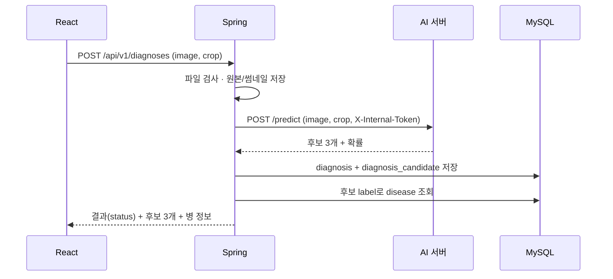

# crop-ai API 명세 (v1 초안)

작물 잎 사진으로 병 후보 3개를 알려주는 앱의 API 명세입니다.
React(앱 화면)와 Spring Boot(백엔드)가 이 문서를 기준으로 만듭니다.

| 항목 | 값 |
|---|---|
| 문서 버전 | v1.1 (2026-11-18) — 로그인을 Google에서 자체 아이디·비밀번호로 변경 |
| 기준 DB | `db/schema.sql` (member, disease, diagnosis, diagnosis_candidate) |
| AI 모델 | `20261118-1305` (MobileNetV2, 17클래스) |

---

## 1. 전체 구조

```text
React (앱 화면)  ──HTTPS──►  Spring Boot (/api/v1/*)  ──HTTP 내부──►  FastAPI AI 서버 (127.0.0.1:8000)
                                   │
                                   ├──► MySQL my_ncpms
                                   └──► 이미지 저장소 (서버 디스크)
```

- **React는 Spring만 호출합니다.** AI 서버는 외부에 열지 않습니다.
- Spring이 AI 서버를 호출할 때는 `X-Internal-Token` 헤더를 붙입니다.

### 진단 한 번의 흐름



---

## 2. 공통 규칙

### 2.1 주소와 형식
- 기본 주소: `/api/v1`
- 요청·응답 본문: `application/json; charset=UTF-8` (사진 업로드만 `multipart/form-data`)
- 날짜·시간: ISO-8601, 한국 시간 (`2026-11-18T22:40:12+09:00`)
- 확률: `0.0 ~ 1.0` 소수, 소수점 4자리 (`0.9712`)
- 작물 코드: `TOMATO` · `POTATO` · `CORN`

### 2.2 인증
- 아이디·비밀번호로 가입·로그인합니다. 비밀번호는 BCrypt 해시로만 저장합니다.
- 로그인 후 받은 **access token(JWT, HS256, 유효 60분)** 을 매 요청에 붙입니다.
  ```text
  Authorization: Bearer <accessToken>
  ```
- 인증 표시: 🔓 = 로그인 없이 호출 가능, 🔒 = 로그인 필요

### 2.3 오류 응답
모든 오류는 같은 형식으로 돌려줍니다.

```json
{
  "code": "INVALID_IMAGE",
  "message": "jpg 또는 png 사진만 올릴 수 있습니다.",
  "timestamp": "2026-11-18T22:40:12+09:00"
}
```

| HTTP | code | 상황 |
|---|---|---|
| 400 | `INVALID_REQUEST` | 필수 값 누락, 형식 오류 |
| 400 | `INVALID_CROP` | 작물 코드가 TOMATO/POTATO/CORN이 아님 |
| 400 | `INVALID_IMAGE` | 깨진 파일, jpg/png 아님 |
| 400 | `INVALID_PASSWORD` | 비밀번호 규칙 위반 (영문+숫자 미포함, 아이디 포함) |
| 401 | `UNAUTHORIZED` | 토큰 없음·만료·위조 |
| 401 | `LOGIN_FAILED` | 아이디 또는 비밀번호 틀림 (어느 쪽인지 알려주지 않음) |
| 403 | `FORBIDDEN` | 다른 사람의 진단 기록에 접근 |
| 404 | `NOT_FOUND` | 진단 기록·병 정보 없음 |
| 409 | `DUPLICATE_LOGIN_ID` | 이미 있는 아이디 |
| 409 | `DUPLICATE_NICKNAME` | 이미 있는 닉네임 |
| 413 | `IMAGE_TOO_LARGE` | 사진 10MB 초과 |
| 423 | `ACCOUNT_LOCKED` | 로그인 5회 연속 실패 → 15분 잠금 |
| 429 | `TOO_MANY_REQUESTS` | 진단 요청 과다 (1인 분당 10회) |
| 503 | `AI_UNAVAILABLE` | AI 서버 응답 없음·오류 (진단은 저장하지 않음) |
| 500 | `INTERNAL_ERROR` | 그 밖의 서버 오류 |

### 2.4 목록 조회 (페이지)
- 요청: `?page=0&size=20` (page는 0부터, size 최대 50)
- 응답:
  ```json
  { "items": [ ... ], "page": 0, "size": 20, "totalItems": 37, "totalPages": 2 }
  ```

---

## 3. 진단 결과 판정 규칙 (Spring)

AI 서버는 항상 후보 3개와 확률만 돌려줍니다. **결과를 어떻게 보여줄지는 Spring이 정합니다.**

| status | 조건 (1순위 기준) | 화면 표시 |
|---|---|---|
| `HEALTHY` | 1순위가 `*___healthy` 이고 확률 ≥ 0.8 | "건강한 잎으로 보입니다" + 후보 3개 |
| `LIKELY` | 1순위 확률 ≥ 0.8 | "○○ 가능성이 높습니다" + 후보 3개 |
| `POSSIBLE` | 0.5 ≤ 1순위 확률 < 0.8 | "다음 병 중 하나일 수 있습니다" + 후보 3개 |
| `UNCERTAIN` | 1순위 확률 < 0.5 | "판단하기 어렵습니다. 다른 각도에서 다시 찍어 주세요" + 후보 3개 |

- **어떤 status든 후보 3개와 "참고용" 안내를 항상 함께 보여줍니다.**
  실제 사진 시험에서 모델이 배우지 않은 병(감자 바이러스, 토마토 ToBRFV 등)도 0.96 이상으로 확신하는 경우가 확인됐습니다.
  그래서 확률이 높아도 "확정 진단"처럼 보이게 하지 않습니다.
- 기준값(0.8 / 0.5)은 Spring 설정값(`app.diagnosis.likely-threshold`, `app.diagnosis.uncertain-threshold`)으로 두고 코드에 박지 않습니다.
- 모델이 아는 병은 17개뿐임을 결과 화면에 안내합니다 (`GET /api/v1/diseases`로 목록 제공).

---

## 4. 인증 · 회원

### 4.1 회원가입 🔓
`POST /api/v1/auth/signup`

요청
```json
{ "loginId": "farmer01", "password": "potato2026!", "nickname": "텃밭지기", "region": "경기", "email": null }
```

| 필드 | 규칙 |
|---|---|
| `loginId` | 필수, 영문 소문자·숫자·밑줄 4~20자, 중복 불가 |
| `password` | 필수, 8~64자, 영문과 숫자 모두 포함, 아이디 포함 금지 |
| `nickname` | 필수, 2~20자, 중복 불가 |
| `region` | 선택, 20자 이하 |
| `email` | 선택 (메일 인증 없음) |

응답 `201`: 4.2와 같은 형식 (가입과 동시에 로그인)

### 4.2 로그인 🔓
`POST /api/v1/auth/login`

요청
```json
{ "loginId": "farmer01", "password": "potato2026!" }
```

응답 `200`
```json
{
  "accessToken": "eyJhbGciOiJIUzI1NiJ9...",
  "tokenType": "Bearer",
  "expiresIn": 3600,
  "member": { "id": 2, "loginId": "farmer01", "nickname": "텃밭지기", "email": null, "region": "경기", "role": "USER",
              "createdAt": "2026-11-18T23:50:00+09:00" }
}
```

- 틀리면 `401 LOGIN_FAILED` — 없는 아이디와 틀린 비밀번호를 같은 메시지로 응답합니다.
  없는 아이디일 때도 비밀번호 비교를 한 번 해서 응답 시간 차이로 아이디 존재 여부를 알 수 없게 합니다.
- **5회 연속 실패하면 15분 잠금** → `423 ACCOUNT_LOCKED`. 성공하면 실패 횟수 초기화.
- 토큰이 만료되면(60분) 다시 로그인합니다 (refresh token 없음).

### 4.3 내 정보 🔒
`GET /api/v1/members/me` → 응답 `200`: 4.2의 `member` 형식

### 4.4 내 정보 수정 🔒
`PATCH /api/v1/members/me`

요청 (바꿀 항목만)
```json
{ "nickname": "텃밭지기", "region": "경기", "email": "" }
```
- nickname 2~20자, 중복이면 `409 DUPLICATE_NICKNAME`
- region·email은 빈 문자열(`""`)을 보내면 지웁니다.

응답 `200`: 4.3과 같은 형식

### 4.5 비밀번호 변경 🔒
`PUT /api/v1/members/me/password`
```json
{ "currentPassword": "potato2026!", "newPassword": "corn2027!!" }
```
- 응답 `204`
- 현재 비밀번호가 틀리면 `401 LOGIN_FAILED`, 새 비밀번호가 규칙 위반이면 `400 INVALID_PASSWORD`
- 이미 발급된 토큰은 만료 시간까지 유효합니다.

### 4.6 회원 탈퇴 🔒
`DELETE /api/v1/members/me`

- 응답 `204`
- 회원의 진단 기록, 후보, 저장된 사진을 모두 지웁니다.

---

## 5. 진단

### 5.1 진단 요청 🔒
`POST /api/v1/diagnoses` (`multipart/form-data`)

| 필드 | 형식 | 필수 | 설명 |
|---|---|---|---|
| `image` | 파일 | ✅ | jpg/png, 최대 10MB |
| `crop` | 문자열 | ✅ | `TOMATO` · `POTATO` · `CORN` |

응답 `201`
```json
{
  "id": 42,
  "crop": "TOMATO",
  "status": "LIKELY",
  "modelVersion": "20261118-1305",
  "createdAt": "2026-11-18T22:40:12+09:00",
  "imageUrl": "/api/v1/diagnoses/42/image",
  "thumbnailUrl": "/api/v1/diagnoses/42/thumbnail",
  "candidates": [
    {
      "rank": 1,
      "confidence": 0.9712,
      "disease": {
        "id": 10,
        "label": "Tomato___Late_blight",
        "nameKo": "토마토 역병",
        "crop": "TOMATO",
        "healthy": false
      }
    },
    { "rank": 2, "confidence": 0.0251, "disease": { "id": 9,  "label": "Tomato___Early_blight", "nameKo": "토마토 겹둥근무늬병", "crop": "TOMATO", "healthy": false } },
    { "rank": 3, "confidence": 0.0037, "disease": { "id": 17, "label": "Tomato___healthy",      "nameKo": "토마토 정상",       "crop": "TOMATO", "healthy": true } }
  ],
  "feedback": null,
  "notice": "AI 진단은 참고용입니다. 정확한 진단은 지역 농업기술센터에 문의하세요."
}
```

처리 순서 (Spring)
1. 파일 크기·형식 검사 (Spring에서 먼저 거름 — AI 서버도 다시 검사함)
2. 원본과 썸네일(긴 변 300px) 저장 → `image_key`, `thumbnail_key`
3. AI 서버 `POST /predict` 호출 (타임아웃 10초)
4. 실패하면 저장한 사진을 지우고 `503 AI_UNAVAILABLE`
5. 성공하면 `diagnosis` 1행 + `diagnosis_candidate` 3행을 **한 트랜잭션**으로 저장
6. 후보 `label` → `disease` 조회 (못 찾으면 `500 INTERNAL_ERROR` + 로그 — 라벨 불일치 신호)
7. 3장의 규칙으로 `status` 결정 후 응답

- `status`는 DB에 저장하지 않고, 조회할 때마다 후보 확률로 다시 계산합니다 (기준값을 바꿔도 기록이 같이 바뀌도록).
- `modelVersion`은 응답에만 포함합니다. 기록에도 남기려면 `diagnosis.model_version` 컬럼 추가를 검토합니다.

### 5.2 내 진단 기록 목록 🔒
`GET /api/v1/diagnoses?page=0&size=20&crop=TOMATO`

- `crop`은 선택 (없으면 전체)
- 최신순

응답 `200`
```json
{
  "items": [
    {
      "id": 42,
      "crop": "TOMATO",
      "status": "LIKELY",
      "topCandidate": { "rank": 1, "confidence": 0.9712, "disease": { "id": 10, "label": "Tomato___Late_blight", "nameKo": "토마토 역병", "crop": "TOMATO", "healthy": false } },
      "thumbnailUrl": "/api/v1/diagnoses/42/thumbnail",
      "feedback": "CORRECT",
      "createdAt": "2026-11-18T22:40:12+09:00"
    }
  ],
  "page": 0, "size": 20, "totalItems": 1, "totalPages": 1
}
```

### 5.3 진단 상세 🔒
`GET /api/v1/diagnoses/{id}`

- 응답 `200`: 5.1과 같은 형식
- 본인 기록이 아니면 `403`, 없으면 `404`

### 5.4 진단 사진 🔒
`GET /api/v1/diagnoses/{id}/image`
`GET /api/v1/diagnoses/{id}/thumbnail`

- 응답 `200`: 이미지 파일 (`image/jpeg` 또는 `image/png`)
- 본인 기록만 볼 수 있습니다. 사진은 웹 루트 밖에 저장하고 이 API로만 내려줍니다.
- React ``에서는 토큰을 헤더로 못 붙이므로, `fetch`로 받아 `blob` URL로 표시합니다.

### 5.5 결과 피드백 🔒
`PUT /api/v1/diagnoses/{id}/feedback`

요청
```json
{ "feedback": "INCORRECT" }
```
- `CORRECT` 또는 `INCORRECT`, 다시 보내면 덮어씀 (`feedback_at` 갱신)
- 응답 `200`: `{ "id": 42, "feedback": "INCORRECT", "feedbackAt": "2026-11-18T22:45:00+09:00" }`
- `INCORRECT` 사진은 나중에 재학습 자료로 씁니다 (사용자 동의 문구를 피드백 버튼 옆에 표시).

### 5.6 진단 기록 삭제 🔒
`DELETE /api/v1/diagnoses/{id}`

- 응답 `204`
- 후보 3행과 저장된 원본·썸네일도 함께 지웁니다.

---

## 6. 병 정보

### 6.1 병 목록 🔓
`GET /api/v1/diseases?crop=TOMATO`

- `crop` 선택, 진단 가능한 17개 안내용

응답 `200`
```json
[
  { "id": 10, "label": "Tomato___Late_blight", "nameKo": "토마토 역병", "crop": "TOMATO", "healthy": false }
]
```

### 6.2 병 상세 🔓
`GET /api/v1/diseases/{id}`

응답 `200`
```json
{
  "id": 10,
  "label": "Tomato___Late_blight",
  "nameKo": "토마토 역병",
  "crop": "TOMATO",
  "healthy": false,
  "description": "잎, 줄기, 열매에 발생하며 ...",
  "treatment": "병든 잎은 일찍 제거하고 ...",
  "source": "농촌진흥청 국가농작물병해충관리시스템(NCPMS)",
  "notice": "약제는 사용 전 제품 라벨과 지역 농업기술센터에 확인하세요."
}
```

- `source`는 공공누리 출처 표시용입니다. 화면에 반드시 보여줍니다.
- `healthy`는 DB 컬럼이 아니라 `label`이 `___healthy`로 끝나는지로 계산합니다.

---

## 7. 내부 API (Spring → AI 서버)

React는 호출하지 않습니다. 이미 구현돼 있는 FastAPI 서버의 형식입니다.

### 7.1 상태 확인
`GET http://127.0.0.1:8000/health`
```json
{ "status": "ok", "model_version": "20261118-1305", "classes": 17 }
```
Spring 시작 시와 1분마다 호출해 AI 서버 상태를 확인합니다 (실패 시 진단 요청을 바로 `503`).

### 7.2 예측
`POST http://127.0.0.1:8000/predict` (`multipart/form-data`)

| 헤더/필드 | 값 |
|---|---|
| `X-Internal-Token` | Spring·AI 서버가 같은 값을 환경변수로 가짐 (`INTERNAL_TOKEN`) |
| `image` | 원본 사진 |
| `crop` | `TOMATO` · `POTATO` · `CORN` |

응답 `200`
```json
{
  "model_version": "20261118-1305",
  "crop": "TOMATO",
  "predictions": [
    { "rank": 1, "label": "Tomato___Late_blight", "confidence": 0.9712 },
    { "rank": 2, "label": "Tomato___Early_blight", "confidence": 0.0251 },
    { "rank": 3, "label": "Tomato___healthy", "confidence": 0.0037 }
  ]
}
```

| AI 서버 응답 | Spring 처리 |
|---|---|
| 400 (잘못된 이미지·작물) | `400 INVALID_IMAGE` / `INVALID_CROP` |
| 401 (토큰 불일치) | 설정 오류 → `503 AI_UNAVAILABLE` + 에러 로그 |
| 413 (10MB 초과) | `413 IMAGE_TOO_LARGE` |
| 타임아웃·연결 실패·5xx | `503 AI_UNAVAILABLE` |

- AI 서버의 snake_case(`model_version`)를 Spring에서 camelCase(`modelVersion`)로 바꿔 React에 전달합니다.

---

## 8. 화면 ↔ API 대응

| 화면 | 호출 API |
|---|---|
| 회원가입 | 4.1 |
| 로그인 | 4.2 |
| 진단하기 (작물 선택 + 촬영/업로드) | 5.1 |
| 진단 결과 | 5.1 응답, 6.2 (후보 눌렀을 때), 5.5 |
| 진단 기록 | 5.2, 5.4 (썸네일) |
| 기록 상세 | 5.3, 5.4, 5.5, 5.6 |
| 진단 가능한 병 목록 | 6.1, 6.2 |
| 내 정보 | 4.3, 4.4, 4.5, 4.6 |

---

## 9. 정할 것 / 나중에

- [ ] `diagnosis.model_version` 컬럼 추가 여부 (모델을 바꾼 뒤 예전 기록 구분용)
- [ ] 사진 저장 위치 (서버 디스크 경로 또는 오브젝트 스토리지)와 보관 기간
- [x] access token 만료 후 처리 → 재로그인 (refresh token 없음)
- [ ] 관리자(ADMIN) 기능 범위
- [ ] 수동 작성 초안 4건(`db/manual_texts.json`) 검토 후 DB 반영 — 검토 전에는 해당 병 상세에 "검토 중" 표시
- [ ] 화면용 한글 병명 3개 확정 (토마토 Early blight / Target spot 등)
